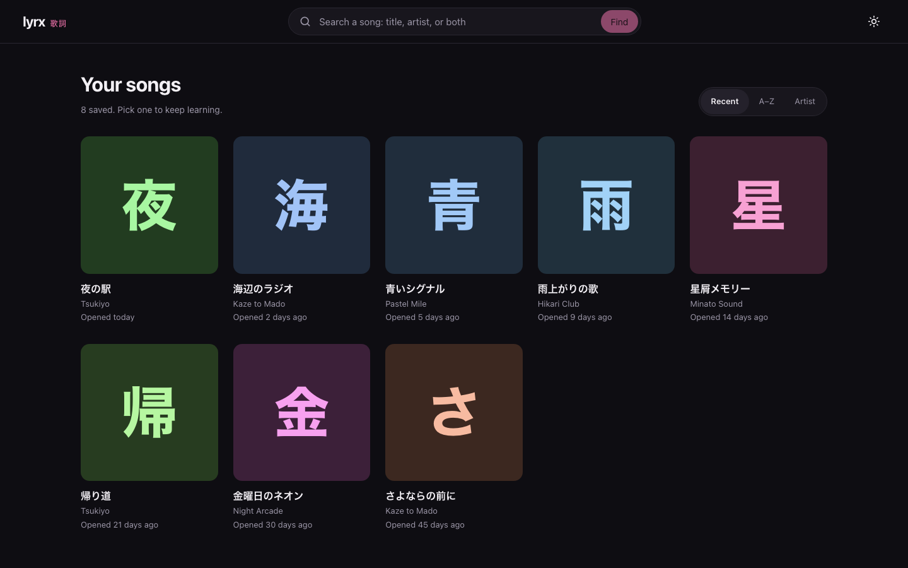
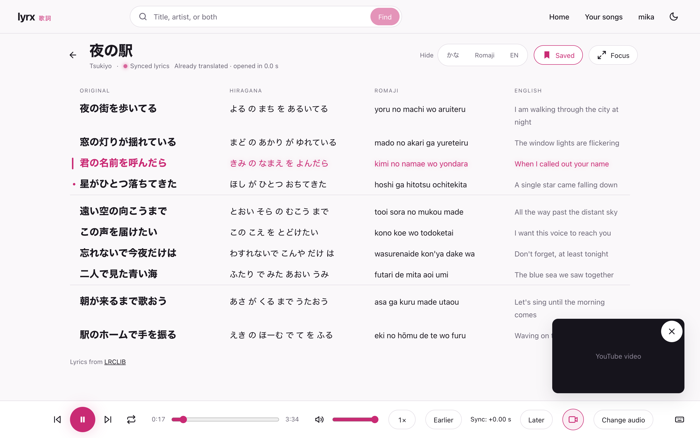
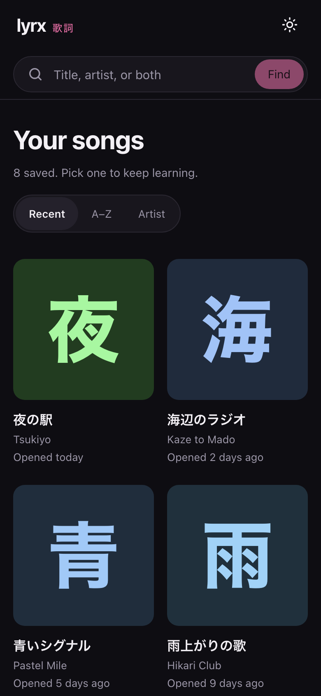
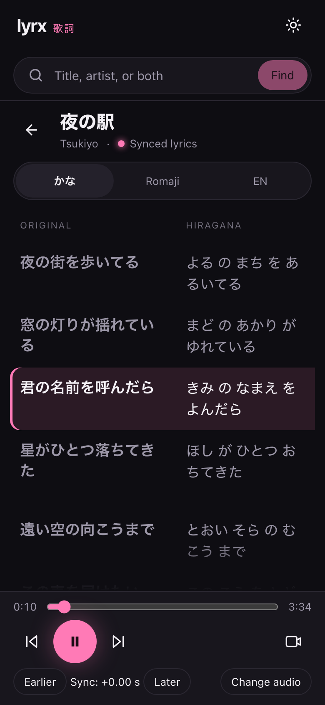

# Lyrx

An app for learning a Japanese song. Type the song's name, and Lyrx shows every line in four columns: Original, Hiragana, Romaji, and English.

The lyrics come from [LRCLIB](https://lrclib.net) (free, no key). A free AI translator makes the hiragana, romaji, and English for every line: Groq first, Gemini as the backup when Groq is busy. The server checks every reply before showing it. Every song you open is kept on your computer (`data/lyrx.db`, gitignored), so opening it again is instant and uses no quota. A line the translator could not do is asked for again, on its own, the next time you open the song.

It runs on your own computer, on `127.0.0.1`, for now.

[AGENTS.md](AGENTS.md) holds the rules and the workflow. [specs/](specs/) holds what is planned and approved.

## Demo

[](docs/demo/lyrx-demo.mp4)

Click the preview for the full demo video (1 min 44 s, with sound).

## Screenshots

The song and lyrics shown are invented for these screenshots.


| Your songs | Light theme |
|---|---|
|  |  |

**On a phone:** the original next to one chosen column, with the player under the lyrics.

<p>
  
  &nbsp;
  
</p>

## What works today

- **Home:** an example line sung part by part shows what Lyrx does, then a large search box. First-time visitors see how it works; returning ones get Continue. "Songs already in Lyrx" opens songs that are already translated, instantly.
- **Your songs (`/library`):** press **Save** on a song to keep it here as a tile, with its YouTube thumbnail when it has a video. Sort by recent, A–Z, or artist.
- **Find a song:** type a title, an artist, or both in the search box at the top. The best match opens at its own address (`/song/{id}`); "Not this one?" lists the others. Back and reload work.
- **Four columns** for every line: Original, Hiragana, Romaji, English. A line no translator could do says "Not available". On a phone, tabs pick one column to show next to the original.
- **Play along:** add a YouTube link or pick an audio file from your computer, and control it from the player bar. The sung line is highlighted and kept in view (timings from LRCLIB). Click a line to jump to it; "Earlier" / "Later" fixes the sync. The video and sync are kept once you save the song. Your file is never uploaded.
- **Focus mode:** hides everything but the lyrics and the player, with bigger text.
- **Study tools:** hide the Hiragana, Romaji, or English column and reveal one line at a time to test yourself; loop the line being sung; keyboard shortcuts for everything (press **?** on any page for the list, **/** to search).
- **Dark and light:** follows your system; the sun/moon button switches and remembers it.

## Coming next

1. Personal accounts, so family and friends can use a hosted copy.
2. Finding the YouTube video automatically (needs a YouTube API key, so it is parked under the no-paid-services rule).

## Setup

You need [uv](https://docs.astral.sh/uv/) (Python 3.12 or later), Node.js with npm, and a free API key from Groq, Gemini, or both (both is best: when one is busy, the other answers).

1. Install the dependencies:
   ```bash
   cd backend && uv sync && cd ..
   cd frontend && npm install && cd ..
   ```
2. Get free keys at [Groq](https://console.groq.com/keys) and [Google AI Studio](https://aistudio.google.com/apikey), then:
   ```bash
   cp .env.example .env
   ```
   Put the keys after `GROQ_API_KEY=` and `GEMINI_API_KEY=` in `.env`. One key is enough; with both, a busy translator hands over to the other. The file is gitignored, so the keys are never committed.

Each request goes to Groq (`gpt-oss-120b`) first. When Groq is busy or out of quota, it goes to Gemini Flash-Lite, then a second Flash-Lite model. The order is `TRANSLATORS` in `backend/src/lyrx/config.py`. Free limits: Groq about 1,000 requests a day and 8,000 tokens a minute per model (about one long song a minute; Gemini takes over when it runs out); Gemini Flash-Lite about 500 requests a day per model. A song is one call per 40 lines, so most songs take 1 or 2 calls. When every translator is at its limit, the page says so; try again later. Google may use what is sent on Gemini's free tier to improve its products.

## Run

Use two terminals.

1. The server, on `127.0.0.1:8000`:
   ```bash
   cd backend
   uv run --env-file ../.env python -m lyrx
   ```
2. The page:
   ```bash
   cd frontend
   npm run dev
   ```
   Open the address it prints (normally `http://127.0.0.1:5173`).

## Check

```bash
scripts/check.sh
```

Backend: ruff format, ruff lint, mypy `--strict`, pytest. Frontend: Prettier, ESLint, `tsc`, Vitest, and the build. No test calls Groq, Gemini, LRCLIB, or the network.

## Folder map

```
lyrx/
├── AGENTS.md              Rules and workflow
├── specs/                 One folder per feature
├── docs/                  README media: demo/ (screen recording, GIF), screenshots/ (invented songs only)
├── scripts/
│   ├── check.sh           Every check in one command
│   └── check-quiet.sh     The same, one line when all pass (only the failing step's tail otherwise)
├── .env.example           The settings: GROQ_API_KEY and GEMINI_API_KEY
├── backend/               Python server (FastAPI, uv)
│   ├── src/lyrx/
│   │   ├── __main__.py        Starts the server on 127.0.0.1
│   │   ├── app.py             Builds the app: the routes, error handlers, and shared clients
│   │   ├── config.py          Every setting in one place
│   │   ├── errors.py          Error codes, their HTTP status, and their message
│   │   ├── schemas.py         What the page sends and receives
│   │   ├── song.py            Open a song: LRCLIB id → every line in four versions
│   │   ├── library.py         The song cache and your saved songs, in one SQLite file
│   │   ├── lyrics/            Finding and preparing lyrics
│   │   │   ├── lrclib.py          LRCLIB: client, search and record requests, record → song
│   │   │   ├── search.py          Typed text → a short ranked list of songs
│   │   │   ├── lines.py           Lyrics → trimmed lines, and each line's start time
│   │   │   └── japanese.py        Kana and kanji, and whether lyrics look Japanese
│   │   ├── translation/       Lines → hiragana, romaji, and English
│   │   │   ├── chain.py           Groq first, Gemini when Groq is busy
│   │   │   ├── chunks.py          Splits a song, sends the chunks at once, retries
│   │   │   ├── prompt.py          What every translator is asked, and the reply shape
│   │   │   ├── checks.py          The checks on every reply: its JSON, then each line
│   │   │   ├── groq.py            Groq: client, one request, reply shape
│   │   │   ├── gemini.py          Gemini: client, one request, reply shape
│   │   │   ├── reply_limits.py    Reads a reply within its byte cap and overall deadline
│   │   │   └── results.py         The internal result shapes
│   │   └── server/            Guards and logging around every request
│   │       ├── host_check.py      Refuses requests not addressed to 127.0.0.1 or localhost
│   │       ├── body_limit.py      Refuses request bodies over 256 KiB before parsing
│   │       ├── crash_guard.py     Turns any unexpected error into a plain 500
│   │       └── request_log.py     One log line per request (no lyrics, no key)
│   └── tests/             The same folders as src/lyrx, one test_<module>.py per module,
│                          plus shared helpers at the top: fake Groq, Gemini, and LRCLIB,
│                          the network guard, the error-shape check, and a raw ASGI runner
└── frontend/              The page (React, Vite, TypeScript)
    └── src/
        ├── main.tsx           Mounts the page
        ├── App.tsx            The app shell: header, pages, search, Focus, ? and / off the song page
        ├── routing.ts         Page addresses: / home, /library your songs, /song/{id} a song
        ├── mediaQuery.ts      Whether a media query matches (reduced motion, light theme, phone)
        ├── styles.css         Night-player colours (dark and light), pages, motion, phone layout
        ├── header/
        │   ├── Header.tsx         The bar on every page: wordmark, search box, Your songs, theme
        │   ├── SearchForm.tsx     The search box and Find button, in two sizes
        │   └── ThemeButton.tsx    The sun/moon button: remembered choice, else the system setting
        ├── home/
        │   ├── HomePage.tsx       Home: hero, large search, how it works or Continue, recent songs
        │   ├── HeroLine.tsx       The example line, sung part by part
        │   └── heroTiming.ts      The example line's parts and which is sung at each tick
        ├── library/
        │   ├── LibraryPage.tsx    Your songs (/library): tiles, sorting, the empty welcome
        │   ├── SongTile.tsx       One tile: art, title, last opened, Remove
        │   ├── SongArt.tsx        A song's art: YouTube thumbnail or first character on its hue
        │   └── songTiles.ts       Thumbnail address, title colour, "Opened …", sort orders
        └── lyrics/
            ├── types.ts           Data shapes shared with the server
            ├── api.ts             The requests to the server, and the checks on their replies
            ├── SearchProgress.tsx While a song loads: kana rain and the terminal-style steps card
            ├── KanaRain.tsx       The falling kana behind the loading steps (canvas)
            ├── SongPage.tsx       A song: header row or Focus strip, lyrics, player bar, study tools
            ├── ColumnButtons.tsx  The phone's column tabs and the Hide toggles
            ├── hiddenColumns.ts   Covered columns (remembered on this browser) and revealed cells
            ├── lineLoop.ts        Where a looped line starts and ends in the audio
            ├── shortcuts.ts       Keyboard shortcuts (song page and elsewhere), when keys are left alone
            ├── ShortcutList.tsx   The keyboard shortcut panel
            ├── SaveButton.tsx     The Save / Saved toggle on a song
            ├── OtherMatches.tsx   "Not this one?": the other results in a popover
            ├── VersionsTable.tsx  The four-column table: sung and looped lines marked, covered cells
            ├── followLine.ts      Calm following: scroll only when the sung line passes 60% of the view
            ├── PlayerBar.tsx      The bar under a song: choosing audio, video window, keeping the sync
            ├── PlayerControls.tsx Previous / play / next, Loop line, position, Earlier/Later sync
            ├── YouTubePlayer.tsx  The YouTube player (privacy-enhanced embed)
            ├── AudioFilePlayer.tsx An audio file from your computer, played in the browser
            ├── playback.ts        Link → video id, the line being sung, the sync, the player clock
            └── fakeSongPage.tsx   Test helpers: a fake YouTube player and server for song page tests
```
