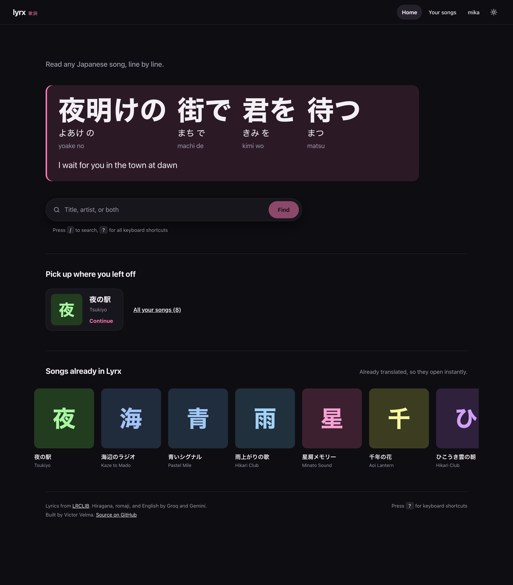

<h1 align="center">lyrx 歌詞</h1>

<p align="center"><strong>Read any Japanese song, line by line.</strong></p>

<p align="center">
  Type a song's name. Lyrx shows every line four ways: the original, hiragana, romaji, and English.<br>
  Then play along with the video while the sung line lights up.
</p>

<p align="center">
  <a href="docs/demo/lyrx-demo.mp4"></a>
</p>

<p align="center"><sub>The song shown is invented. Click the preview for a longer walkthrough with sound (recorded on an earlier build).</sub></p>

---

## Features

- **One search box.** Type a title, an artist, or both. The best match opens right away, and "Not this one?" lists the others.
- **Four columns, one row per line.** Original, hiragana, romaji, and English, side by side. On a phone, tabs pick which reading sits next to the original.
- **Play along.** Paste a YouTube link or play an audio file from your computer (it is never uploaded). The sung line lights up and stays in view, using LRCLIB's line timings. Click a line to jump to it, nudge the sync earlier or later, slow down to 0.75× or 0.5×, and loop a single line.
- **Study tools.** Hide the hiragana, romaji, or English column and reveal one line at a time to test yourself. Focus mode shows only the lyrics and the player, with larger text.
- **Your songs.** Save a song with its video and sync. Sort and filter your library, and pick up where you left off from the home page.
- **Instant reopen.** Every translated song is cached, so opening it again is instant and costs no quota. Anyone can open songs already in Lyrx.
- **Accounts without email.** A username and a password. Guests can search and play along; saving needs an account.
- **Keyboard first.** Press <kbd>?</kbd> on any page for the full list, and <kbd>/</kbd> to search.
- **Dark and light.** Follows your system setting, with a switch that remembers your choice.

## Screenshots

<sub>Every song and lyric line in these images is invented.</sub>

<p align="center">
  
</p>

| Light theme | Your songs |
|---|---|
|  |  |

<p align="center">
  
</p>


## How it works

```
 search box ──► LRCLIB search ──► ranked matches (Japanese first, duplicates removed)
                                        │
 open a song ──► cache hit? ── yes ──► instant reply
                     │ no
                     ▼
             LRCLIB lyrics + line timings
                     │
                     ▼
     Groq (Gemini as backup) ──► schema + script checks ──► cache ──► page
       chunks of 40 lines            hiragana: no kanji
       sent in parallel              romaji: no kana or kanji
```

- **Lyrics** come from [LRCLIB](https://lrclib.net). It is free and needs no key.
- **Readings and translation** come from free-tier AI models, with Groq first. When Groq is busy or out of quota, the same request goes to Gemini. The lyrics are sent as data, never as instructions.
- **Every reply is checked** against a strict schema before it is used. A line that fails is asked for again on its own. A line that still fails shows "Not available" and is retried the next time the song opens.
- **Limits keep the free tier healthy.** New (uncached) songs are capped each day: 20 per account, 20 per guest, and 300 for the whole site.

## Tech stack

| | |
|---|---|
| **Backend** | Python 3.12+, FastAPI, uvicorn, SQLite, managed with [uv](https://docs.astral.sh/uv/) |
| **Frontend** | React 19, TypeScript, Vite. No UI library: hand-written CSS with design tokens |
| **Quality** | ruff, mypy `--strict`, pytest · Prettier, ESLint (strict, type-checked), `tsc`, Vitest + Testing Library |
| **Services** | LRCLIB (lyrics), Groq and Gemini free tiers (readings and translation). No paid APIs. |

## Getting started

**You need:**
- [uv](https://docs.astral.sh/uv/) (Python 3.12 or later);
- Node.js with npm;
- a free API key from [Groq](https://console.groq.com/keys), [Google AI Studio](https://aistudio.google.com/apikey) (Gemini), or both. One is enough; with both, a busy translator hands over to the other.

```bash
# 1. Install
cd backend && uv sync && cd ..
cd frontend && npm install && cd ..

# 2. Add your keys (the file is gitignored)
cp .env.example .env        # then fill in GROQ_API_KEY and/or GEMINI_API_KEY

# 3. Run the server (terminal 1), on 127.0.0.1:8000
cd backend && uv run --env-file ../.env python -m lyrx

# 4. Run the page (terminal 2)
cd frontend && npm run dev  # open http://127.0.0.1:5173
```

<details>
<summary>Free-tier limits and the translator order</summary>

Each request goes to Groq (`gpt-oss-120b`) first, then to Gemini Flash-Lite, then to a second Flash-Lite model. The order is `TRANSLATORS` in [`backend/src/lyrx/config.py`](backend/src/lyrx/config.py).

Rough free limits:
- Groq: about 1,000 requests a day and 8,000 tokens a minute per model, which is about one long song a minute.
- Gemini Flash-Lite: about 500 requests a day per model.

A song takes one call per 40 lines, so most songs need one or two calls. When every translator is at its limit, the page says so. Google may use what is sent on Gemini's free tier to improve its products.

</details>

<details>
<summary>Resetting a friend's password</summary>

There is no email, so a forgotten password is reset by hand. From `backend/`:

```bash
uv run python -m lyrx.accounts.reset_password <username>
```

It asks for the new password twice and signs that person out everywhere.

</details>

## Checks

```bash
scripts/check.sh         # everything, with full output
scripts/check-quiet.sh   # one line when it all passes
```

- Backend: ruff format, ruff lint, mypy `--strict`, and pytest.
- Frontend: Prettier, ESLint, `tsc`, Vitest, and the production build.
- No test calls Groq, Gemini, LRCLIB, or the network: a guard fails any test that tries.

## Project structure

```
lyrx/
├── backend/                  Python server
│   ├── src/lyrx/
│   │   ├── app.py              Builds the app: routes, error handlers, shared HTTP clients
│   │   ├── config.py           Every setting in one place
│   │   ├── schemas.py          What the page sends and receives
│   │   ├── errors.py           Error codes, their HTTP status, and their message
│   │   ├── song.py             Open a song: LRCLIB id → every line in four versions
│   │   ├── library.py          The shared song cache and each person's saved songs
│   │   ├── database.py         The SQLite file and its tables
│   │   ├── rate_limits.py      Daily caps on new songs, sign-ups, and failed sign-ins
│   │   ├── accounts/           Passwords (scrypt), users, session cookies, account routes
│   │   ├── lyrics/             LRCLIB client, search ranking, lines and timings, Japanese detection
│   │   ├── translation/        Translator chain, chunking, prompt, reply checks, Groq, Gemini
│   │   └── server/             Guards on every request: Host, Origin, body size, crash guard, log
│   └── tests/                The same folders, one test_<module>.py per module, plus fakes
├── frontend/                 The page
│   ├── index.html            Page shell: title, link preview, icons
│   ├── public/               Favicon, phone icon, link preview image
│   └── src/
│       ├── main.tsx            Mounts the app
│       ├── App.tsx             The shell: header, page switch, search and open flow
│       ├── api.ts              Every server call, reply checks, and error wording
│       ├── types.ts            Shared data shapes
│       ├── routing.ts          Addresses: /, /library, /song/{id}, /account
│       ├── browser.ts          Media queries and remembered settings
│       ├── icons.tsx           Every icon
│       ├── styles.css          Design tokens (dark and light), layout, motion, phone layout
│       ├── account/            Sign in, create, sign out, delete; who is signed in
│       ├── header/             The top bar and the theme switch
│       ├── search/             Search box, loading screen, kana rain
│       ├── shortcuts/          Keyboard shortcuts and their list
│       ├── home/               Home page and the animated example line
│       ├── library/            Your songs: tiles, sorting, filter, Undo
│       ├── song/               The song page: four-column table, study tools, following
│       └── player/             Player bar, YouTube and audio-file players, playback rules
├── specs/                    One short spec per feature, from idea to done
├── docs/                     README media (invented songs only)
├── scripts/                  check.sh and check-quiet.sh
└── AGENTS.md                 The rules every contributor (human or agent) follows
```

## Roadmap

- [x] Search, four versions, saved songs, synced playback, study tools, accounts
- [ ] Public hosting with Docker and Caddy
- [ ] More languages, one at a time (Korean next: hangul, romanization, English)

## How this project is built

Every change starts as a short spec in [`specs/`](specs/), is built with a test for each acceptance check, and lands as a reviewed pull request. [AGENTS.md](AGENTS.md) holds the rules: security first, then correctness, then a working page, then polish.

## Credits

- Lyrics and line timings from [LRCLIB](https://lrclib.net), a free, community-run lyrics database.
- Readings and translations by [Groq](https://groq.com) and [Google Gemini](https://ai.google.dev).
- Built by Victor Velma.
